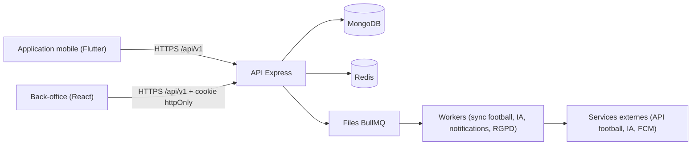
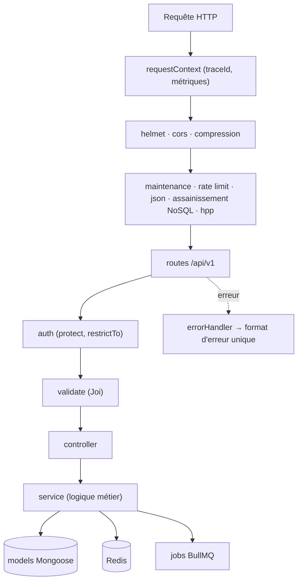

<p align="center"></p>

<h1 align="center">Univers Barça — API Backend</h1>

<p align="center">API REST de l’application mobile et du back-office : authentification, données football, jeux, communauté, IA, notifications.</p>

<p align="center">
  <a href="https://github.com/TheGoatIA/univers_barca_api/actions/workflows/backend-ci.yml"></a>
  
  
</p>

> Application communautaire **non officielle** pour les supporters du FC Barcelone. Voir [`NOTICE.md`](NOTICE.md) pour les droits d'image et de marque.

## 1. Le produit en bref

**Univers Barça** est une application mobile (iOS / Android) qui rassemble, pour les supporters du FC Barcelone, tout ce qu'ils font autour du club : suivre le calendrier et les matchs, jouer chaque jour (_Guess the Player_, _Quiz adaptatif_), composer une équipe _Fantasy_, découvrir _La Masia_, retrouver d'autres supporters près de chez eux (_carte_ et _groupes locaux_), discuter avec un **assistant IA** borné aux faits, générer des **fonds d'écran IA**, recevoir des **notifications** et suivre sa progression dans le _Culé Passport_.

Le projet est composé de **trois dépôts** qui forment un seul système :

| Dépôt                                                                       | Rôle                                           | Technologie                              |
| --------------------------------------------------------------------------- | ---------------------------------------------- | ---------------------------------------- |
| [`univers_barca_mobile`](https://github.com/TheGoatIA/univers_barca_mobile) | Application des supporters                     | Flutter 3.47.7, BLoC, Chopper, Drift     |
| [`univers_barca_admin`](https://github.com/TheGoatIA/univers_barca_admin)   | Back-office (contenu, modération, supervision) | React 18, Vite, TypeScript, Tailwind     |
| [`univers_barca_api`](https://github.com/TheGoatIA/univers_barca_api)       | API REST, jobs, données                        | Node 22, Express, MongoDB, Redis, BullMQ |



## 2. Ce que fait l'API

- **Identité** : inscription avec consentements RGPD, connexion, vérification e-mail, OAuth, mot de passe oublié, JWT de 15 min + _refresh token_ à rotation et détection de réutilisation, blacklist Redis, sessions et appareils ; authentification **distincte** du back-office (cookie httpOnly, 2FA TOTP, rôles `content-manager`, `moderator`, `super-admin`).
- **Football** : joueurs, équipes, compétitions, matchs (calendrier, événements, compositions), synchronisation avec l'API football, contenus éditoriaux et traductions FR/EN/ES.
- **Jeux & gamification** : défi quotidien _Guess the Player_, _Quiz adaptatif_, scoring, streaks, classements, _Culé Passport_ (XP, badges), comparateur GOAT, Fantasy, La Masia.
- **Communauté** : carte (positions approximatives agrégées), groupes locaux, posts, événements, signalements et modération (journal d'audit immuable).
- **IA** : assistant conversationnel borné aux faits (streaming), quotas, modération ; génération de fonds d'écran.
- **Calendrier & notifications** : export ICS / abonnement, jetons d'appareil, envois FCM, centre de notifications, campagnes.
- **Plateforme** : files BullMQ, cron, caches Redis, feature flags, maintenance, supervision, métriques Prometheus, traces OpenTelemetry.

## 3. Architecture technique



Conventions : **routes → middleware → controller → service → model**, pas d'injection de dépendances ni de pattern Repository ; réponses `{ success, data }` ; erreurs `AppError.*` ; validation Joi ; tout handler async passe par `catchAsync`. Détails : [vue d'ensemble](docs/architecture/01-vue-ensemble.md) et [architecture de données](docs/architecture/02-architecture-donnees.md).

| Brique            | Choix                                                                   |
| ----------------- | ----------------------------------------------------------------------- |
| Runtime / langage | Node.js 22, TypeScript strict                                           |
| Web               | Express 4, helmet, cors, compression, hpp, express-rate-limit (+ Redis) |
| Données           | MongoDB 7 (replica set) via Mongoose 9, migrations `migrate-mongo`      |
| Cache / files     | Redis (ioredis), BullMQ, node-cron                                      |
| Sécurité          | Argon2id, JWT HS256, TOTP (speakeasy), validation Joi                   |
| Observabilité     | Winston, prom-client (`/metrics`), OpenTelemetry, Swagger (`/api-docs`) |
| Process           | PM2 en cluster (`ecosystem.config.js`)                                  |
| Tests             | Jest + Supertest, k6 (charge)                                           |

## 4. Structure du dépôt

```text
src/
  app.ts · server.ts · tracing.ts      assemblage Express, démarrage + arrêt gracieux, OpenTelemetry
  config/        env (Joi), database, redis, metrics
  middleware/    auth, validate, errorHandler, rateLimiter, requestLogger, maintenance
  routes/        définition des routes + JSDoc @swagger
  controllers/   adaptation HTTP (minces)
  services/      logique métier (auth, token, password, user, admin-auth, health…)
  validators/    schémas Joi
  models/        collections Mongoose par domaine
  jobs/          files BullMQ, tâches cron
  docs/          génération OpenAPI
  utils/         AppError, catchAsync, response, pagination, sanitize, logger
scripts/         migrations, seed, export Swagger, backup/restore, setup VPS, entrypoint, k6 runner
tests/           unit · integration · e2e · security · load (k6)
docker/          compose dev / staging / production / observabilité, Prometheus, Grafana
docs/            architecture, base de données, déploiement, reprise après sinistre, ADR, pilotage
.github/         workflows CI/CD, templates d'issues et de PR, backlog
```

## 5. Démarrage rapide

Prérequis : **Node 22+**, **Docker** (MongoDB + Redis).

```bash
cp .env.example .env                                   # puis remplacer les secrets : openssl rand -base64 48
docker compose -f docker/docker-compose.dev.yml up -d mongodb mongo-init redis
npm ci
npm run migrate:up                                     # index et migrations
npm run seed                                           # données de démonstration (+ super-admin si ADMIN_BOOTSTRAP_*)
npm run dev                                            # http://localhost:5000
```

| URL                                | Rôle                                                        |
| ---------------------------------- | ----------------------------------------------------------- |
| `GET /health` · `GET /health/deep` | Liveness · readiness (MongoDB + Redis)                      |
| `GET /metrics`                     | Prometheus (IP autorisées : `METRICS_ALLOWED_IPS`)          |
| `/api-docs`                        | Swagger UI (Basic auth `SWAGGER_USER` / `SWAGGER_PASSWORD`) |
| `/api/v1/*`                        | API versionnée                                              |

## 6. Configuration (variables d'environnement)

Toutes validées au démarrage par Joi (échec immédiat si un invariant de sécurité est violé). Modèle : [`.env.example`](.env.example).

| Variable                                                                                | Rôle                                                      |
| --------------------------------------------------------------------------------------- | --------------------------------------------------------- |
| `NODE_ENV`, `PORT`, `API_VERSION`, `LOG_LEVEL`, `CORS_ORIGINS`                          | Exécution et CORS (liste blanche)                         |
| `MONGODB_URI`                                                                           | MongoDB (replica set requis)                              |
| `REDIS_URL`                                                                             | Redis (**obligatoire en production**)                     |
| `JWT_ACCESS_SECRET`, `JWT_REFRESH_SECRET`                                               | ≥ 32 caractères, **différents**                           |
| `JWT_ACCESS_TTL`, `JWT_REFRESH_TTL_DAYS`                                                | 15 min · 30 jours par défaut                              |
| `SWAGGER_USER`, `SWAGGER_PASSWORD`                                                      | Accès Swagger (≥ 16 caractères en production)             |
| `METRICS_ALLOWED_IPS`                                                                   | IP autorisées pour `/metrics`                             |
| `OTEL_EXPORTER_OTLP_ENDPOINT`, `OTEL_SERVICE_NAME`                                      | Traces OpenTelemetry                                      |
| `ADMIN_BOOTSTRAP_EMAIL`, `ADMIN_BOOTSTRAP_PASSWORD`                                     | Super-admin initial (seed)                                |
| `FOOTBALL_API_KEY`, `AI_TEXT_API_KEY`, `AI_IMAGE_API_KEY`, `FCM_SERVICE_ACCOUNT_BASE64` | Services externes                                         |
| `MAINTENANCE_MODE`, `RATE_LIMIT_DISABLED` (hors production)                             | Maintenance · désactivation du limiteur (tests de charge) |

## 7. Commandes

| Commande                                                                             | Description                                                          |
| ------------------------------------------------------------------------------------ | -------------------------------------------------------------------- |
| `npm run dev` · `npm run build` · `npm start`                                        | Développement (tsx watch) · compilation + `swagger.json` · démarrage |
| `npm run lint` · `format` · `format:check` · `typecheck`                             | ESLint 9, Prettier, `tsc --noEmit`                                   |
| `npm run test:unit` · `test:integration` · `test:e2e` · `test:security` · `test:all` | Pyramide de tests (MongoDB requis hors unitaires)                    |
| `npm run check:swagger` · `export:swagger`                                           | Non-régression du contrat OpenAPI                                    |
| `npm run load:smoke` · `load:load` · `load:stress` · `load:spike` · `load:soak`      | Tests de montée en charge k6 ([guide](docs/LOAD_TESTING.md))         |
| `npm run migrate:up` · `migrate:down` · `migrate:create`                             | Migrations                                                           |
| `npm run seed`                                                                       | Données de démonstration                                             |

## 8. Qualité, tests et sécurité

- **Pyramide** : unitaires (logique pure), intégration (routes + MongoDB), e2e (parcours), **sécurité** (en-têtes, injections NoSQL, JWT falsifié, contrôle d'accès, fuite d'informations), **charge** k6 (obligatoire pour toute nouvelle route : [LOAD_TESTING](docs/LOAD_TESTING.md)).
- **CI** (`backend-ci.yml`, sur PR vers `dev`/`main`) : ESLint, Prettier, types, contrat OpenAPI, commitlint, tests, build Docker, audit (TruffleHog, Trivy, npm audit).
- **Sécurité** : Argon2id, JWT 15 min + refresh à rotation, blacklist Redis, Helmet, CORS en liste blanche, limitation de débit, assainissement NoSQL, secrets validés au démarrage. Voir [SECURITY.md](SECURITY.md) et [Sécurité et RGPD](docs/architecture/03-securite-et-rgpd.md).

## 9. CI/CD et déploiement

| Branche | Environnement | Image Docker                                             | Tag git              |
| ------- | ------------- | -------------------------------------------------------- | -------------------- |
| `dev`   | staging       | `ghcr.io/thegoatia/univers_barca_api:staging-AAAAMMJJ.N` | `staging-AAAAMMJJ.N` |
| `main`  | production    | `ghcr.io/thegoatia/univers_barca_api:prod-AAAAMMJJ.N`    | `vAAAAMMJJ.N`        |

Pipeline `backend-deploy.yml` : vérification → version `AAAAMMJJ.N` → build/push GHCR (Dockerfile multi-stage, utilisateur non-root, tini) → déploiement SSH sur le VPS (attente MongoDB healthy, recréation du seul service `backend`, health check, **rollback automatique**) → tag de release → notification Slack. Sans secrets VPS, l'image est publiée et le déploiement est ignoré. Guide complet : [DEPLOYMENT](docs/DEPLOYMENT.md), [DISASTER_RECOVERY](docs/DISASTER_RECOVERY.md) et [Déploiement et CI/CD](docs/architecture/04-deploiement-et-cicd.md).

## 10. Documentation

| Document                                                                                                                                | Contenu                                                              |
| --------------------------------------------------------------------------------------------------------------------------------------- | -------------------------------------------------------------------- |
| [Index de la documentation](docs/architecture/README.md)                                                                                | Point d'entrée : par où commencer selon votre rôle                   |
| [Registre des décisions](docs/DECISIONS.md)                                                                                             | Décisions D01–D19 et incohérences tranchées                          |
| [Vue d'ensemble de l'architecture](docs/architecture/01-vue-ensemble.md)                                                                | Architecture globale, conteneurs, couches, carte des fonctionnalités |
| [Architecture de données](docs/architecture/02-architecture-donnees.md)                                                                 | Collections, relations, index, Redis, Drift, cycle de vie            |
| [Sécurité et RGPD](docs/architecture/03-securite-et-rgpd.md)                                                                            | Authentification, RBAC, protection des données                       |
| [Déploiement et CI/CD](docs/architecture/04-deploiement-et-cicd.md)                                                                     | Environnements, pipelines, versionnage, rollback                     |
| [Observabilité et qualité](docs/architecture/05-observabilite-et-qualite.md)                                                            | Logs, métriques, tests, charge                                       |
| [Glossaire et conventions](docs/architecture/06-glossaire-et-conventions.md)                                                            | Vocabulaire, conventions de code et de contribution                  |
| [Architectures par fonctionnalité](docs/architecture/features/)                                                                         | 24 documents (flux, données, API, écrans)                            |
| [Plan de réalisation](docs/pilotage/PLAN_REALISATION.md) · [Suivi Excel](docs/pilotage/Univers-Barca-Plan-de-realisation-et-suivi.xlsx) | Étapes, jalons, Gantt                                                |
| [Contribuer](CONTRIBUTING.md) · [Sécurité](SECURITY.md) · [Journal des changements](CHANGELOG.md) · [Décisions (ADR)](docs/adr/)        | Gouvernance du projet                                                |

### Les 24 fonctionnalités

| Réf. | Fonctionnalité                           | Phase | Document d'architecture                                                                                               |
| ---- | ---------------------------------------- | ----- | --------------------------------------------------------------------------------------------------------------------- |
| F01  | Authentification et comptes              | 1     | [F01-authentification-et-comptes.md](docs/architecture/features/F01-authentification-et-comptes.md)                   |
| F02  | Onboarding et personnalisation           | 1     | [F02-onboarding-et-personnalisation.md](docs/architecture/features/F02-onboarding-et-personnalisation.md)             |
| F03  | Paramètres, confidentialité et RGPD      | 1     | [F03-parametres-confidentialite-rgpd.md](docs/architecture/features/F03-parametres-confidentialite-rgpd.md)           |
| F04  | États système et résilience              | 0-1   | [F04-etats-systeme-et-resilience.md](docs/architecture/features/F04-etats-systeme-et-resilience.md)                   |
| F05  | Données football et synchronisation      | 1     | [F05-donnees-football-et-synchronisation.md](docs/architecture/features/F05-donnees-football-et-synchronisation.md)   |
| F06  | Accueil — dashboard                      | 1     | [F06-accueil-dashboard.md](docs/architecture/features/F06-accueil-dashboard.md)                                       |
| F07  | Historique et fiches                     | 1     | [F07-historique-et-fiches.md](docs/architecture/features/F07-historique-et-fiches.md)                                 |
| F08  | Calendrier et export agenda              | 1     | [F08-calendrier-et-export-agenda.md](docs/architecture/features/F08-calendrier-et-export-agenda.md)                   |
| F09  | Guess the Player                         | 1     | [F09-guess-the-player.md](docs/architecture/features/F09-guess-the-player.md)                                         |
| F10  | Quiz adaptatif                           | 1     | [F10-quiz-adaptatif.md](docs/architecture/features/F10-quiz-adaptatif.md)                                             |
| F11  | Comparateur GOAT                         | 2     | [F11-comparateur-goat.md](docs/architecture/features/F11-comparateur-goat.md)                                         |
| F12  | Culé Passport et gamification            | 2     | [F12-passport-et-gamification.md](docs/architecture/features/F12-passport-et-gamification.md)                         |
| F13  | Fantasy Barça                            | 2     | [F13-fantasy-barca.md](docs/architecture/features/F13-fantasy-barca.md)                                               |
| F14  | La Masia Academy                         | 3     | [F14-la-masia-academy.md](docs/architecture/features/F14-la-masia-academy.md)                                         |
| F15  | Carte communautaire                      | 2     | [F15-carte-communautaire.md](docs/architecture/features/F15-carte-communautaire.md)                                   |
| F16  | Groupes locaux                           | 2     | [F16-groupes-locaux.md](docs/architecture/features/F16-groupes-locaux.md)                                             |
| F17  | Modération et sécurité communautaire     | 2     | [F17-moderation-et-securite-communautaire.md](docs/architecture/features/F17-moderation-et-securite-communautaire.md) |
| F18  | Assistant IA Barça AI                    | 1     | [F18-assistant-ia-barca-ai.md](docs/architecture/features/F18-assistant-ia-barca-ai.md)                               |
| F19  | Wallpapers IA                            | 3     | [F19-wallpapers-ia.md](docs/architecture/features/F19-wallpapers-ia.md)                                               |
| F20  | Notifications                            | 1     | [F20-notifications.md](docs/architecture/features/F20-notifications.md)                                               |
| F21  | Back-office : contenu éditorial          | 1     | [F21-backoffice-contenu.md](docs/architecture/features/F21-backoffice-contenu.md)                                     |
| F22  | Back-office : supervision et comptes     | 1     | [F22-backoffice-supervision-et-comptes.md](docs/architecture/features/F22-backoffice-supervision-et-comptes.md)       |
| F23  | Design system et expérience              | 0     | [F23-design-system-et-experience.md](docs/architecture/features/F23-design-system-et-experience.md)                   |
| F24  | Plateforme : jobs, caches, feature flags | 0-1   | [F24-plateforme-jobs-cache-flags.md](docs/architecture/features/F24-plateforme-jobs-cache-flags.md)                   |

## 11. Backlog et organisation du travail

- Le backlog complet est dans les **issues GitHub** de ce dépôt : titre `[CODE] …`, jalon = phase (0 à 3), labels `priorite:*`, `taille:*`, `type:*`, `module:*`. Chaque issue contient contexte, maquettes (clair/sombre), règles de gestion, contrats d'API, tâches, critères d'acceptation et tests à écrire.
- Ordre de traitement : **phase → priorité (P0, P1, P2) → ordre des codes dans l'épopée**, en respectant la section « Dépendances » (qui peut pointer vers un autre dépôt : `API-…`, `MOB-…`, `ADM-…`). Détails dans [`CLAUDE.md`](CLAUDE.md).
- Git : `main` = production, `dev` = intégration/staging, branches `feat/<n°issue>-<slug>` ; commits [Conventional Commits](https://www.conventionalcommits.org/fr/) ; PR vers `dev` avec CI verte.
- Versions de déploiement : `AAAAMMJJ.N` (tags `staging-…` sur `dev`, `v…` sur `main`).
- Un push sur `dev` déploie le **staging** ; un push sur `main` déploie la **production**.

## 12. Licence et droits

Logiciel propriétaire (voir [`LICENSE`](LICENSE)). L'écusson du FC Barcelone utilisé comme logo reste la propriété du club : voir [`NOTICE.md`](NOTICE.md).
