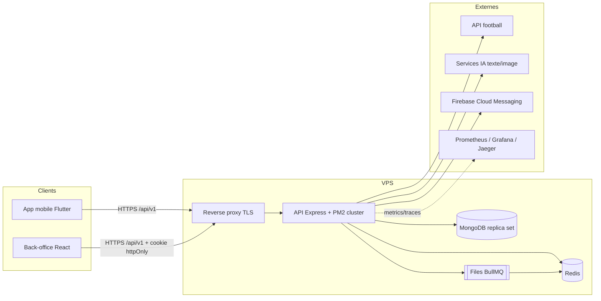
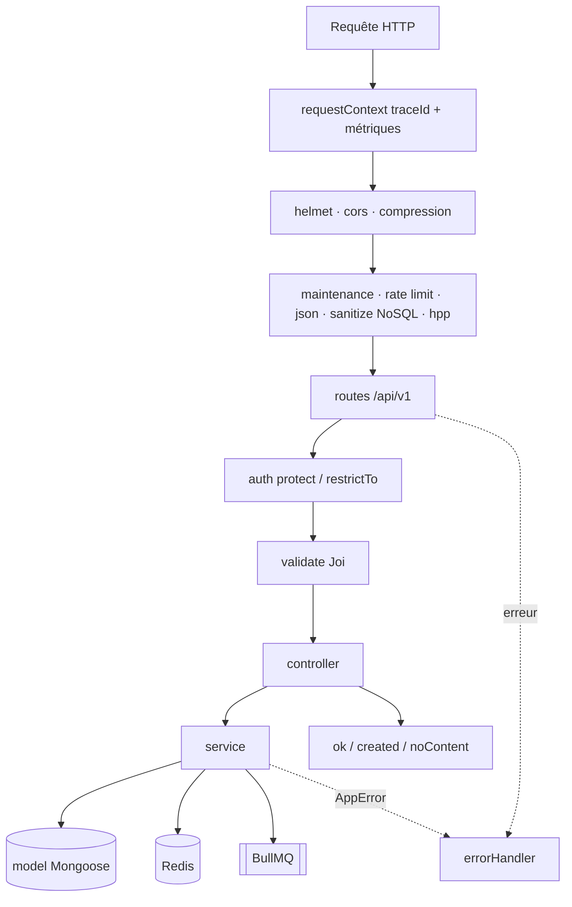
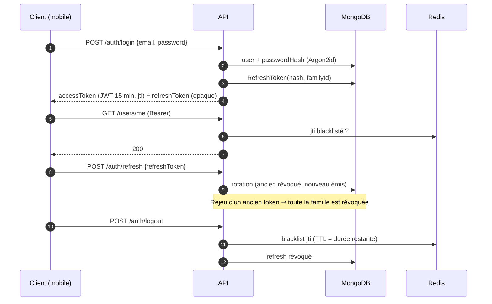
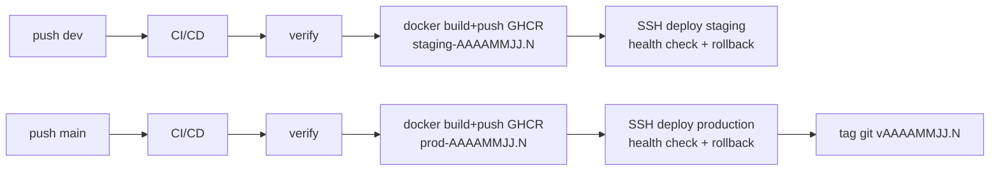

# Architecture de l'API

## 1. Vue d'ensemble (contexte)



## 2. Couches applicatives



Règles : pas d'injection de dépendances, pas de pattern Repository. Les contrôleurs sont minces (`catchAsync`), la logique est dans `services/`, les modèles ne connaissent pas HTTP.

## 3. Arborescence

```
src/
  app.ts · server.ts · tracing.ts
  config/       env (Joi), database, redis (store clé/valeur), metrics
  middleware/   auth, validate, errorHandler, rateLimiter, requestLogger, maintenance
  routes/       index.ts (+ JSDoc @swagger)
  controllers/  auth, user, admin-auth, content, health
  services/     auth, token, password, user, admin-auth, health
  validators/   schémas Joi
  models/       collections Mongoose (par domaine)
  jobs/         queues BullMQ, scheduler node-cron
  docs/         génération OpenAPI
  utils/        AppError, catchAsync, response, pagination, sanitize, logger
scripts/        migrations, seed, export-swagger, backup/restore, setup-vps, entrypoint
tests/          unit · integration · e2e · security · load (k6)
docker/         compose dev / staging / production / observabilité
```

## 4. Authentification



Back-office : connexion email + mot de passe (+ TOTP), refresh token en cookie **httpOnly / SameSite=Strict / path restreint**, session 8 h, verrouillage 15 min après 5 échecs, rôles `content-manager` · `moderator` · `super-admin`.

## 5. Jobs et tâches planifiées

| Élément                                                                         | Rôle                                                                                                                                        |
| ------------------------------------------------------------------------------- | ------------------------------------------------------------------------------------------------------------------------------------------- |
| Files BullMQ `email`, `notifications`, `football-sync`, `ai-generation`, `rgpd` | Une file par domaine, 5 tentatives avec backoff exponentiel, file `dead-letter` pour les échecs définitifs, métrique `ub_jobs_failed_total` |
| node-cron 03:00                                                                 | Purge RGPD des comptes supprimés depuis 30 jours (instance PM2 0 uniquement)                                                                |
| node-cron 03:30                                                                 | Purge des refresh tokens révoqués anciens                                                                                                   |

## 6. Déploiement



Voir [DEPLOYMENT.md](DEPLOYMENT.md).

## 7. Observabilité

- Logs Winston JSON (rotation 14 j), champs sensibles masqués, `X-Request-Id` propagé (`traceId`).
- Métriques Prometheus : latence HTTP par route, échecs d'authentification, jobs en échec, métriques Node.
- Traces OpenTelemetry (OTLP) si `OTEL_EXPORTER_OTLP_ENDPOINT` est défini.
- Alertes : API indisponible, latence p95, taux de 5xx, jobs en échec (`docker/prometheus/alerts.yml`).
