# Base de données MongoDB

MongoDB 7 en **replica set** (même en développement, pour les transactions). Données du domaine « contenu » embarquées (événements de match, compositions) ; références (`ObjectId`) pour les entités indépendantes.

```mermaid
erDiagram
  USER ||--o{ REFRESH_TOKEN : possède
  USER ||--o{ CONSENT_RECORD : historise
  USER ||--o| USER_PROGRESS : progresse
  USER ||--o{ GUESS_ATTEMPT : tente
  USER ||--o{ QUIZ_SESSION : joue
  USER ||--o| FANTASY_TEAM : compose
  USER ||--o{ GROUP_MEMBERSHIP : rejoint
  COMMUNITY_GROUP ||--o{ GROUP_MEMBERSHIP : contient
  COMMUNITY_GROUP ||--o{ GROUP_POST : publie
  MATCH }o--|| TEAM : domicile
  MATCH }o--|| TEAM : extérieur
  MATCH }o--|| COMPETITION : appartient
  PLAYER ||--o{ GUESS_ATTEMPT : cible
  USER ||--o{ DEVICE_TOKEN : enregistre
  USER ||--o{ CHAT_CONVERSATION : converse
  ADMIN_USER ||--o{ ADMIN_SESSION : ouvre
  ADMIN_USER ||--o{ AUDIT_LOG : agit
  MODERATION_REPORT ||--o{ MODERATION_ACTION : déclenche
```

## Collections par domaine

| Domaine         | Collections                                                                                                                                                                 |
| --------------- | --------------------------------------------------------------------------------------------------------------------------------------------------------------------------- |
| Identité        | `users`, `refreshtokens` (TTL), `consentrecords`                                                                                                                            |
| Back-office     | `adminusers`, `adminsessions` (TTL), `auditlogs`                                                                                                                            |
| Football        | `players`, `teams`, `competitions`, `matches`                                                                                                                               |
| Gamification    | `dailychallenges`, `guessattempts`, `quizquestions`, `quizsessions`, `userprogresses`, `badges`, `scoringrules`                                                             |
| Fantasy / Masia | `fantasyteams`, `fantasyleagues`, `academyplayers`                                                                                                                          |
| Communauté      | `communitygroups` (2dsphere), `groupmemberships`, `groupposts`, `locationaggregates`                                                                                        |
| Modération      | `moderationreports`, `moderationactions`, `auditlogs`                                                                                                                       |
| Plateforme      | `chatconversations`, `generatedwallpapers`, `notificationpreferences`, `devicetokens`, `notificationlogs`, `calendarsubscriptions`, `featureflags`, `aiquotas`, `anecdotes` |

## Règles

- Index définis dans les schémas **et** garantis par la migration `20261015000000-initial-indexes`.
- Index TTL : `refreshtokens.expiresAt`, `adminsessions.expiresAt`.
- Index sparse+unique pour les champs optionnels uniques (`users.email`, `players.externalRef`).
- Géolocalisation : seules des positions **approximatives** (centre de ville) sont stockées ; les agrégats `locationaggregates` ne contiennent aucune donnée individuelle.
- Contenus localisés : champ `{ fr, en, es }` ; le français est obligatoire, EN/ES requis avant publication (statut `awaiting-translation`).
- Suppression de compte : anonymisation immédiate puis purge à J+30 (job RGPD).
- Données sensibles (`passwordHash`, jetons, secret TOTP) en `select: false`, jamais renvoyées par l'API.
